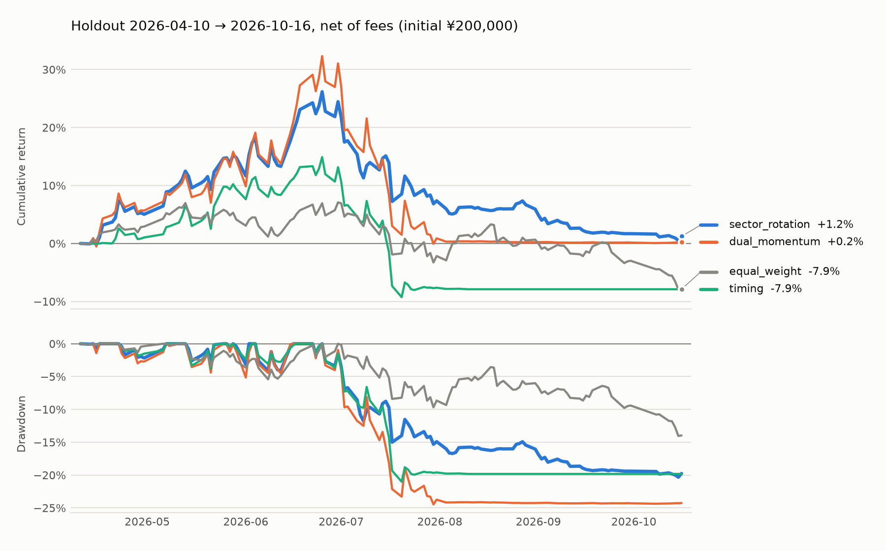

# FuGuoCup Quant

**Sector momentum in Fullgoal OTC funds: an out-of-sample test net of subscription/redemption costs and settlement lags**

Personal research project · Python · pandas · NumPy · [中文](README.md)

> None of the 9 pre-specified strategies shows a stable out-of-sample edge after fees. `sector_rotation`, which drives the live signal, is positive in only 3 of 8 rolling folds and returns +1.23% in the holdout — after first rising to +26.2% and then drawing down 20.3%. Costs are the same order of magnitude as returns. The more durable output is the research infrastructure: point-in-time data-quality isolation, an explicit subscription/redemption ledger, and results reproducible by hash.

## Summary

| | |
|---|---|
| Question | Can cross-sectional sector momentum with a trend filter produce a stable risk-adjusted return in Fullgoal OTC funds after subscription/redemption fees, T+1 confirmation, T+3 settlement and purchase limits? |
| Sample | 2021-01-04 → 2026-10-16; 500 tradeable funds in the backtest (from 917 catalog codes) |
| Validation | Fixed parameters, no search; 252-day initial train → 8 × 126-day rolling folds → 126-day holdout |
| Conclusion | Sector momentum is not a stable alpha here. Rolling and holdout signs disagree for most strategies; momentum-type strategies pay fees of 2.7%–3.5% of initial capital in the holdout |
| Status | Research mode. No strategy passes the deployment gate; the live signal is a forward paper record only |

All numbers come from [`sample_results/2026-10-16/`](sample_results/2026-10-16/) (`model_hash ad4a7a6`, `config_hash 0b02a25`, snapshot `sha256 191bb947`). Re-running on the same snapshot reproduces them bit for bit.

## Hypotheses

| Hypothesis | Test | Result |
|---|---|---|
| H1: 20-day momentum persists at the sector level | Top-2 sectors by average `mom20`, fund selection within sector | **Not supported.** `sector_rotation` is positive in 3 of 8 folds, fold returns range −16.12% to +23.99%; compounded rolling return −4.38% |
| H2: Trend filters and risk budgeting contain drawdowns | `timing` breadth gate; `risk_budget` correlation screen + inverse vol + 12% vol target | **Partly supported.** `risk_budget` holdout drawdown 10.44% vs 20%–28% for momentum strategies, but its rolling return is −10.60% |
| H3: Fees and settlement lags materially erode the signal | Explicit subscription fee, FIFO redemption tiers, minimum holding, T+1/T+3 | **Supported.** Momentum strategies turn over 7.9–11.2× in the holdout and pay ¥5,332–7,049 in fees, comparable to holdout returns |

## Data

| Stage | Count | Notes |
|---|---:|---|
| Fullgoal catalog codes | 917 | Discovered from the company page; manager ID verified per fund |
| OTC funds | 808 | Excludes exchange-traded ETFs, exchange money-market funds, REITs |
| Scoring cross-section | 701 | Collected successfully with ≥128 NAV rows; 96 too short, 11 unsupported |
| Tradeable backtest set | 500 | Model-supported (excludes QDII, FOF, money-market, lock-up/periodic-open) with ≥252 rows |

- **Data quality**: 348 of 917 funds (38%) have breaks between unit NAV and vendor returns that dividends/splits do not explain. Breaks are isolated point in time: history is not deleted retroactively, history length restarts after a break, and any backtest segment holding a fund across a break is invalid — returns are never spliced.
- **Auditability**: raw responses and derived CSVs carry SHA-256 hashes; snapshots can be rebuilt offline from archived responses.
- **Share-class dedup**: A/C share classes are grouped by name and only one share per underlying is kept, so the same exposure is not counted twice.

## Method

### Features

All features use only NAVs completed on or before the signal date (signal lag T−2).

| Feature | Definition |
|---|---|
| `mom20/60/126` | `P_t / P_{t−n} − 1` |
| `vol20/60` | daily return std × √252 |
| `trend` | `P_t / mean(P_{t−119..t}) − 1` |
| `drawdown60` | `P_t / max(P_{t−59..t}) − 1` |
| `risk_adjusted` | `mom60 / max(vol60, 0.01)` |
| `multi_momentum` | 0.25·`mom20` + 0.35·`mom60` + 0.40·`mom126` |
| `score` | 30% rank(`mom20`) + 30% rank(`mom60`) + 20% rank(`risk_adjusted`) + 20% rank(−`vol60`) |

### Strategies

Every strategy except `equal_weight` drops funds with `drawdown60 ≤ −20%` and holds at most 3 funds. "Breadth scaling" classifies the market by the share of equity funds with `trend>0 and mom60>0`: risk_on (≥60%), mixed (≥35%), risk_off; total exposure is multiplied by 1.0, 0.75 and 0.5 respectively.

| Strategy | Rule |
|---|---|
| `cash` | All cash |
| `equal_weight` | Equal weight across all tradeable funds; the pre-specified benchmark |
| `momentum` | `mom60>0`, ranked by `mom60`; breadth scaling |
| `relative_strength` | `mom20>0`, ranked by `risk_adjusted`; breadth scaling |
| `sector_rotation` | Top-2 sectors with positive average `mom20`; within them `mom60>0`, ranked by `score`; breadth scaling |
| `timing` | `trend>0 and mom60>0`, ranked by `score`; full exposure at breadth ≥60%, 40% at ≥35%, otherwise flat |
| `dual_momentum` | Equity funds with `multi_momentum>0`, `trend>0`, `drawdown60>−15%`; falls back to bond funds with `mom60>0` in risk_off or with no candidates; breadth scaling |
| `risk_budget` | `dual_momentum` candidates + 60-day correlation screen (<0.85) + inverse-vol weights, 12% annual vol target |
| `ensemble` | Average of the `momentum`, `dual_momentum` and `risk_budget` weights |

**Portfolio constraints**: single fund ≤35%, single sector ≤50%, total exposure ≤95%, enforced in the weight projection rather than clipped afterwards.

### Execution and costs

A purpose-built event-driven ledger tracks cash, per-lot units, receivables and in-flight orders daily; no third-party backtester, no leverage.

| Item | Assumption |
|---|---|
| Timing | T−2 signal → submit on T → confirm T+1 → redemption cash at T+3; unsettled redemptions cannot fund purchases |
| Subscription fee | 0.15%, charged on top |
| Redemption fee | FIFO by lot age: <7 days 1.5%, <365 days 0.5%; no redemption before 7 days |
| Rebalance | First trading day of each week |
| Missing data | Missing NAVs, trades without NAV and quality breaks are recorded as errors per segment; never filled with zero or spliced returns |

Fees are research assumptions, not verified per-fund rates; competition mode requires per-fund rates with sources.

## Validation design

- **Split**: the first 252 observations are the initial training window; then 8 non-overlapping 126-day folds (2022-01-17 → 2026-03-19); the last 126 observations (2026-04-10 → 2026-10-16) are the holdout.
- **Continuous ledger**: positions, fees, confirmations and settlements roll across folds; cash is not reset per fold.
- **Fixed parameters**: all 9 strategies were specified before seeing results; no parameter search and no picking a winner from the holdout.
- **Deployment gate**: the approximate 95% lower bound of mean per-fold excess return over `equal_weight` must be >0; rolling and holdout returns must both be positive; the holdout must beat the benchmark with drawdown ≤30%.
- **Known biases**: the holdout has been viewed and is no longer unseen; 9 strategies × 8 folds is a multiple-comparison problem, so single-fold excess is not treated as significance. Promotion requires forward evidence.

**Metric definitions**: rolling return is the compounded return of the 8 folds on the continuous ledger; annualisation uses 252 days; Sharpe uses daily returns with a zero risk-free rate; turnover is holdout two-sided traded value ÷ average assets; max drawdown is peak-to-trough within the holdout.

## Results

| Strategy | Rolling return | Positive folds | Holdout return | Holdout ann. | Max DD | Sharpe | Turnover | Fees (¥) |
|---|---:|---:|---:|---:|---:|---:|---:|---:|
| `cash` | 0.00% | 0/8 | 0.00% | 0.00% | 0.00% | 0.00 | 0.00 | 0 |
| `equal_weight` | not verifiable | — | −7.87% | −15.13% | 14.04% | −0.89 | 1.21 | 468 |
| `momentum` | not verifiable | — | +0.13% | +0.25% | 27.91% | 0.17 | 8.48 | 5,876 |
| `relative_strength` | not verifiable | — | −7.10% | −13.69% | 21.72% | −0.56 | 11.18 | 7,049 |
| **`sector_rotation`** | **−4.38%** | 3/8 | **+1.23%** | +2.47% | 20.33% | 0.22 | 9.20 | 6,357 |
| `timing` | +21.79% | 3/8 | −7.90% | −15.17% | 21.01% | −0.71 | 9.23 | 5,941 |
| `dual_momentum` | +1.00% | 3/8 | +0.20% | +0.40% | 24.47% | 0.16 | 8.43 | 5,718 |
| `risk_budget` | −10.60% | 1/8 | +0.15% | +0.30% | 10.44% | 0.08 | 5.42 | 3,513 |
| `ensemble` | not verifiable | — | −0.03% | −0.06% | 21.58% | 0.12 | 7.90 | 5,332 |

Initial capital ¥200,000; all figures net of fees. "Not verifiable": the strategy held a fund across an unexplained NAV break on 2022-04-06, so its development backtest is invalid and no spliced return is substituted.

<picture>
  <source media="(prefers-color-scheme: dark)" srcset="docs/figures/holdout-dark.png">
  
</picture>

**Findings**

1. **No robust out-of-sample edge.** Only `dual_momentum` is positive in both the rolling period and the holdout (+1.00% / +0.20%), economically indistinguishable from zero. `timing` (+21.79% / −7.90%), `risk_budget` (−10.60% / +0.15%) and `sector_rotation` (−4.38% / +1.23%) flip sign between the two, i.e. performance is regime-dependent.
2. **The holdout is dominated by one episode.** All three momentum strategies peaked on 2026-06-25 (`sector_rotation` +26.2%, `dual_momentum` +32.3%, `timing` +14.9%) and gave nearly all of it back when the market turned risk_off in July; exposure then shifted largely to cash, with `timing` 100% cash from September. Near-zero holdout returns hide 20%–24% drawdowns, and 126 days are too short to separate the signal from a single market episode.
3. **Costs are binding.** Momentum strategies turn over 7.9–11.2× in the holdout, with fees of 2.7%–3.5% of initial capital — the same order as returns. That is with weekly rebalancing; the live signal updates daily, which would cost more and has not been backtested.
4. **The formal gate cannot be computed — by design.** The `equal_weight` benchmark itself crosses a NAV break, so the per-fold excess test is undefined and the system refuses to promote any strategy rather than manufacturing a result from spliced returns.
5. **Results are sensitive to universe composition.** An earlier version with a different universe and code ([`sample_results/review/`](sample_results/review/)) had `sector_rotation` at −2.47% rolling and +1.20% holdout; numbers drift as the universe changes, which is why every result here is pinned to hashes.

## Forward paper record

On every A-share trading day at 14:20 the system sends the `sector_rotation` research signal to Telegram, explicitly labelled as research mode and not an approved model. Because the holdout has been viewed, this live record is the genuine forward sample for any future promotion decision.

The delivery path is built to production standards: GitHub's native cron was measured hours late, so an external scheduler triggers GitHub Actions (native cron is kept as a backup); the slow collection and evaluation finish before 14:20; report generation and sending are gated to 14:20–14:55; a persisted reservation precedes every send to prevent duplicates; run status is written to logs and the step summary, late or undelivered runs fail and alert, and an independent dead-man check watches for runs that never start. See [scheduling](docs/scheduling.md) and [operations](docs/OPERATIONS.md) (Chinese).

## Engineering

- `src/fullgoal_quant/` separates data, universe, signals, ledger, portfolio, report and notifications; every research run writes a manifest with config hash, source hash and time windows.
- 119 regression tests cover timing and look-ahead, fees and settlement, missing data and quality breaks, accounts, notification dedup and scheduling states; CI runs Python 3.11 / 3.12 / 3.13 plus a smoke test against live public data.
- Public logs and artifacts contain no account report, outbox or tokens.

```text
src/fullgoal_quant/
  data.py        collection, parsing, archiving and SHA-256
  universe.py    OTC classification, share groups, manager verification
  signals.py     features, strategies and portfolio constraints
  backtest.py    event-driven ledger: fees, confirmation, settlement
  research.py    fixed-plan rolling validation and manifest
  portfolio.py   real account and rebalance proposal
  report.py      report and daily signal text
  calendar.py    official trading calendar
  notifications.py / runstatus.py   send reservation, dedup and run status
```

## Limitations

- **Survivorship bias**: no complete catalog of delisted funds; the universe contains surviving funds only.
- **Data timing**: vendor NAVs are revised after the fact; T−2 mitigates publication delay but does not prove point-in-time availability. Historical trading days are proxied by domestic equity NAV dates.
- **Cost assumptions**: fees, confirmation/settlement days and purchase limits are research defaults, not verified per fund; slippage is set to 0.
- **Short holdout**: the 126-day holdout is dominated by one episode and has little statistical power.

## Next steps

- **Validation**: replace the viewed holdout with the forward record; block-bootstrap confidence intervals for per-fold excess; multiple-comparison correction (e.g. deflated Sharpe).
- **Data**: point-in-time universe with delisted funds; NAV publication timestamps to replace the T−2 proxy.
- **Signal**: decompose sector selection vs fund selection; equal vs size-weighted sector aggregation; robustness to momentum windows.
- **Costs**: net cost of daily vs weekly rebalancing; calibrate fees against real platform statements.

## Reproduce

```bash
python3 -m venv .venv && source .venv/bin/activate
python -m pip install .
python -m unittest discover -s tests -b

fq collect                  # collect public data (data/ is not versioned)
fq research --out reports/research
pip install matplotlib && python scripts/plot_holdout.py sample_results/2026-10-16 docs/figures
```

`data/` is not under version control. On the same snapshot (see [`provenance.json`](sample_results/2026-10-16/provenance.json)) the table reproduces bit for bit; re-collecting yields different numbers because of vendor NAV revisions and universe changes.

## Documents

[Methodology](docs/METHODOLOGY.md) · [Operations](docs/OPERATIONS.md) · [Scheduling](docs/scheduling.md) · [Deployment](docs/DEPLOYMENT.md) · [Review](docs/REVIEW.md) (Chinese)

## Disclaimer

Personal research and competition-support project; not investment advice. The system only produces analysis and never places orders; all trades are made by the author on the competition platform.
