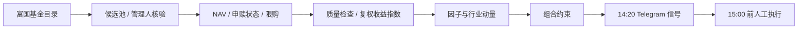

# FuGuoCup Quant

**富国杯场外基金量化研究与每日信号系统**

只研究富国基金旗下场外产品。每个交易日 14:20 生成目标组合，15:00 结算前由本人手动执行。系统不登录比赛平台、不自动下单，也不把研究信号伪装成成交记录。

| 项目 | 当前设置 |
|---|---|
| 比赛 | 第六届富国杯 · 2026-10-19 → 2027-04-30 |
| 初始资金 | ¥200,000（虚拟） |
| 候选池 | 富国基金 · 场外 · 管理人逐只核验 |
| 信号 | 每日 14:20 · `sector_rotation` |
| 执行 | 人工 · 15:00 前 |
| 当前模式 | 研究信号（不产生可执行金额） |

## 设计原则

- **Universe first.** 先确定“能买什么”，再讨论“买什么”。销售目录、风险标签和申购状态都不等于比赛白名单或官方适当性等级。
- **Evidence over optimization.** 固定参数、滚动验证、独立测试；不根据已经看过的测试曲线搜索参数或切换赢家。
- **Signal, not execution.** 系统给目标权重、方向和参考金额；成交、费用、确认日与限购以比赛平台为准。
- **Reproducibility.** 配置、源码哈希、时间窗和数据来源均落盘；任何结果都能追溯到当时的输入。
- **Fail closed.** 数据不完整、净值断点、日历未核验或账户未核对时，宁可停止，不填造收益。

## 分析框架



**候选池。** 从富国基金公司页关联目录抓取产品，逐只打开详情页核验管理人 ID；排除 QDII、FOF、货币、黄金/商品、非联接 ETF、场内、持有期/定开/封闭、后端收费、期限/滚动/分级及无法映射类别的产品。债券指数（Eastmoney “指数型-固收”）按债券处理，转债/混合一级/二级/偏债单独标记。A/C 等份额按名称分组，同一底层只保留一个份额。

**数据。** 每只基金保存单位净值、供应商日收益率、分红/拆分事件、申购/赎回状态和限购金额；原始响应与 CSV 均记录 SHA256。复权收益指数由供应商日收益连乘，不对累计净值直接做百分比变化。单位净值变化与供应商收益不一致且无事件解释时标记 `quality_break`，该段不拼接收益，持仓跨断点则回测判为无法验证。

**因子。** 使用过去 128 个观测计算 20/60/126 日动量、20/60 日波动、120 日均线偏离、60 日回撤和风险调整动量。信号只使用 T-2 及之前已完成的净值，避免把尚未公布的当日净值带入决策。

**组合。** 默认 `sector_rotation`：先按行业聚合 20 日动量，取动量为正的前 2 个行业；再在行业内选 60 日动量为正、综合评分最高的至多 3 只基金；最后施加单基金 ≤35%、单行业 ≤50%、总仓位 ≤95%、同一份额组仅一只的约束，剩余为现金。

## 策略与验证

研究采用 252 个观测初始训练、126 个观测一折的滚动窗口，最后 126 个观测单列为历史测试。2026-10-17 的全量运行结果：

| 策略 | 滚动验证 | 最终历史测试 | 最大回撤 | 夏普 |
|---|---:|---:|---:|---:|
| `sector_rotation` | +0.21% | **+1.20%** | 21.44% | 0.22 |
| `timing` | +21.18% | -6.13% | 18.70% | -0.60 |
| `risk_budget` | -6.96% | +0.37% | 10.23% | 0.12 |
| `equal_weight` | 无法验证 | -7.87% | 14.04% | -0.89 |
| `cash` | 0.00% | 0.00% | 0.00% | 0.00 |

`timing` 的滚动验证最高，但最终测试为负；`sector_rotation` 是唯一在滚动验证和最终测试中都为正的策略，因此作为当前信号策略。**最终测试区间已经查看，不再算未见样本；历史结果不代表未来。**

等权基准仍保留为研究基准，`deployment_approved` 保持为 `false`。没有新的前瞻证据前，系统不会自动晋级候选模型，也不会产生可执行金额。

## 每日信号

只有 **14:20（北京时间）** 的定时任务会采集并发送信号；08:30 和 20:30 仍会触发工作流，但云步骤直接退出，避免重复采集和重复消息。

Telegram 消息包含：

- 目标组合的总仓位与现金比例；
- 每只基金的目标权重和 `买入/建仓、加仓、减仓、清仓、持有` 方向；
- 按报告账户估值计算的参考金额；
- 信号截止日、计划交易日和 **15:00 前完成买入/调整**的提示。

```text
第六届富国杯信号｜2026-10-19 14:20｜策略 sector_rotation｜市场 risk_on
目标组合（合计 70.0%，现金 30.0%）：
161024 富国中证军工A｜目标 35.0%｜买入/建仓｜参考 ¥70,000
...
信号截止 2026-10-15；计划交易日 2026-10-19。
研究信号，非成交指令；不提供可执行金额。
每日 15:00 前按目标权重买入/调整；参考金额按账户估值估算，非成交指令；不保证收益。
```

参考金额只是按账户估值和目标权重计算的估算值，**不替代平台确认、费用和每日限购**。正式下单路径会读取申购/赎回状态与限购金额并封顶；Telegram 参考金额用于快速判断量级，下单前请以平台页面为准。

## 快速开始

需要 Python 3.11–3.13，运行依赖只有 `numpy` 和 `pandas`。

```bash
python3 -m venv .venv
source .venv/bin/activate
python -m pip install .
python -m unittest discover -s tests -v

fq doctor --limit 12          # 有界真实接口验收，不覆盖完整池
fq collect                    # 采集全部受支持的富国场外候选
fq research                   # 固定方案滚动验证

cp config/account.example.json config/account.local.json
fq report --research --account config/account.local.json
```

常用命令：

```bash
fq discover                                   # 刷新目录与支持/不支持原因
fq --data data/smoke research                 # 用抽样数据跑研究
fq --data data/expanded backtest --baseline-eight
fq calendar-check --year 2027                 # 官方完整公告未发布时保留拦截
fq account validate --file config/account.local.json
fq validate                                   # 正式模式静态配置检查
fq collect --competition                      # 只采集已核验的比赛白名单
```

## 配置

`config/settings.json` 中最重要的字段：

| 字段 | 含义 |
|---|---|
| `competition.allowed_codes` | 比赛官方可交易代码；为空时研究模式使用自动发现的富国场外池 |
| `rules` / `fund_rules` | 真实费率、确认/赎回到账、最短持有、最小金额等；正式模式逐只核验 |
| `signal.strategy` | 每日信号策略，当前 `sector_rotation` |
| `signal.daily` / `signal.buy_deadline` | 每日信号与 15:00 执行截止提示 |
| `universe.workers` | 采集并发，当前 8 |
| `data.max_nav_lag_sessions` | 允许的净值滞后；超过后报告阻断 |

账户文件：

- `config/account.example.json`：空仓模板，可提交；
- `config/account.local.json`：真实账户，已被 Git 忽略；
- GitHub Secret `ACCOUNT_JSON`：云端使用的完整实际账户。

```json
{
  "as_of": "2026-10-19",
  "reconciled_at": "2026-10-19T14:05:00+08:00",
  "cash": 200000,
  "lots": [],
  "pending": [],
  "acknowledged_plan_id": null
}
```

`lots` 逐批填写真实确认份额与确认日；`pending` 单独记录在途申购/赎回，避免重复计入现金和持仓。正式决策要求当日 `as_of`、4 小时内带时区的 `reconciled_at`，且没有在途资产。

## 自动化

GitHub Actions 使用北京时间 **08:30 / 14:20 / 20:30** 三个触发点，但只有 14:20 会执行采集与发送。云端先恢复可信分支的持久化发送状态，生成预约，**上传预约 artifact 成功后才调用 Telegram**，最后保存发送结果；超时或崩溃后的预约不会盲目重发。日志和公开 artifact 不包含账户报告、outbox 或凭证。

需要的 Secrets：

- `TELEGRAM_BOT_TOKEN`
- `TELEGRAM_CHAT_ID`
- `ACCOUNT_JSON`

Token 只从环境变量读取，不记录带 Token 的请求 URL。手动验证可在 Actions 中运行 `Trading day reports`，将 `send` 设为 true；周末会走测试路径，正常交易日则按 14:20 窗口执行。

## 数据边界

- 当前目录仍有幸存者偏差；没有完整历史退市基金目录。
- 供应商净值是事后修订版；T-2 只缓解发布延迟，不能证明每个历史时点完全可得。
- 历史交易日用国内权益参考净值日期代理；当前与未来操作必须通过官方年度日历。2027 年完整安排未发布前，系统保留未知日期拦截。
- 费用、确认日、到账日和申赎状态在正式模式下必须逐只核验；研究模式的默认值只是假设。
- 系统不保证收益或比赛排名。任何信号都应由本人核对规则、限购和实际持仓后执行。

## 项目结构

```text
src/fullgoal_quant/
  data.py         采集、解析、归档与 SHA256
  universe.py     富国场外分类、份额组与管理人核验
  signals.py      因子、策略与组合约束
  backtest.py     账务、费用、确认与回测
  research.py     滚动验证与 manifest
  portfolio.py    实际账户与调仓提案
  report.py       报告、每日信号与 Telegram 文本
  calendar.py     官方交易日历与 2027 解析
  telegram.py     推送与错误脱敏
tests/            70 项回归测试
scripts/          云端运行、发送、状态恢复与安全检查
config/           settings / calendar / account.example
docs/             方法、部署、迁移与审查记录
sample_results/   可复现研究证据（历史）
```

## 文档

[研究方法](docs/METHODOLOGY.md) · [部署与验收](docs/DEPLOYMENT.md) · [审查报告](docs/REVIEW.md) · [AI 评估](docs/AI_ASSESSMENT.md)

## 免责声明

本项目仅用于个人研究与比赛辅助，不构成投资建议。历史回测、供应商净值和现有候选池都存在偏差；系统不保证收益，也不对任何实际交易结果负责。交易由本人在比赛平台完成，执行前请自行核对规则、限购和账户状态。
